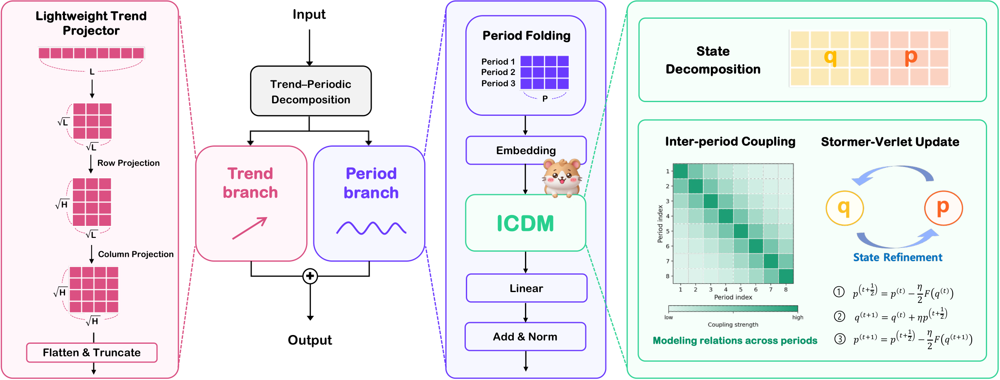

<p align="center">
  
</p>

<h1 align="center">HAMSTAR</h1>

<h3 align="center">Hamiltonian Structured Inter-Period Refinement<br>for Long-Term Time Series Forecasting</h3>

<p align="center">
  <strong>NeurIPS 2026</strong><br>
  Jaeyo Chang<sup>*</sup> &nbsp; Seohyun Kim<sup>*</sup> &nbsp; Dong-Joon Lim<sup>†</sup><br>
  <sub>jaeyo0427@g.skku.edu &nbsp; seohyun.kim@skku.edu &nbsp; tgno3@skku.edu</sub><br>
  <sub>* Equal contribution. Author order determined by coin flip.<br>
  † Corresponding author.</sub>
</p>

<p align="center">
  <a href="#overview">Overview</a> ·
  <a href="#quick-start">Quick start</a> ·
  <a href="#citation">Citation</a>
</p>

## Overview

HAMSTAR represents time series as period-aligned latent states and refines
them with the Inter-Period Coupled Dynamics Module (ICDM). Structured
inter-period coupling supplies the refinement signal, and Störmer–Verlet
updates iteratively transform the split latent states. A lightweight trend
branch models the remaining low-frequency component.

<p align="center">
  
</p>

This repository contains the model and scripts for 10 datasets and 4
forecasting horizons: **96, 192, 336, and 720**. All scripts use an input
length of 720.

## Quick start

### 1. Install

```bash
git clone https://github.com/HAMSTAR-NeurIPS/HAMSTAR.git
cd HAMSTAR

python -m pip install -r requirements.txt
```

### 2. Prepare data

Place the CSV files in `dataset/`:

```text
HAMSTAR/
└── dataset/
    ├── ETTh1.csv
    ├── ETTh2.csv
    ├── ETTm1.csv
    ├── ETTm2.csv
    ├── weather.csv
    ├── electricity.csv
    ├── solar.csv
    ├── CzeLan.csv
    ├── temp.csv
    └── pm2_5.csv
```

### 3. Train and evaluate

Run one dataset at all four horizons:

```bash
bash scripts/ettm1.sh
```

Run all 40 configurations:

```bash
bash scripts/run_all.sh
```

Each script trains the model, selects a checkpoint using validation loss,
and evaluates it on the test split. The scripts use one run per setting
with seed 2023. Checkpoints are saved under `checkpoints/`, and metrics
are appended to `results/results.csv`.

## Datasets

| Dataset | CSV file | Variables | Run script |
| --- | --- | ---: | --- |
| ETTh1 | `ETTh1.csv` | 7 | [`etth1.sh`](scripts/etth1.sh) |
| ETTh2 | `ETTh2.csv` | 7 | [`etth2.sh`](scripts/etth2.sh) |
| ETTm1 | `ETTm1.csv` | 7 | [`ettm1.sh`](scripts/ettm1.sh) |
| ETTm2 | `ETTm2.csv` | 7 | [`ettm2.sh`](scripts/ettm2.sh) |
| Weather | `weather.csv` | 21 | [`weather.sh`](scripts/weather.sh) |
| Electricity | `electricity.csv` | 321 | [`electricity.sh`](scripts/electricity.sh) |
| Solar | `solar.csv` | 137 | [`solar.sh`](scripts/solar.sh) |
| CzeLan | `CzeLan.csv` | 11 | [`czelan.sh`](scripts/czelan.sh) |
| Temp | `temp.csv` | 184 | [`temp.sh`](scripts/temp.sh) |
| PM2.5 | `pm2_5.csv` | 184 | [`pm2_5.sh`](scripts/pm2_5.sh) |

## Citation

If you use HAMSTAR in your research, please cite:

```bibtex
@inproceedings{chang2026hamstar,
  title     = {HAMSTAR: Hamiltonian Structured Inter-Period Refinement for Long-Term Time Series Forecasting},
  author    = {Chang, Jaeyo and Kim, Seohyun and Lim, Dong-Joon},
  booktitle = {Advances in Neural Information Processing Systems},
  year      = {2026}
}
```

## Acknowledgements

We are grateful to the researchers and maintainers who make their work
openly available. We especially thank the teams behind:

- [**TimeBase**](https://github.com/hqh0728/TimeBase)
- [**Time Series Library (TSLib)**](https://github.com/thuml/Time-Series-Library)
- [**GluonTS**](https://github.com/awslabs/gluonts)

Their commitment to open-source research makes it easier for others to
explore ideas, reproduce experiments, and contribute new work.

## License

HAMSTAR is released under the [MIT license](LICENSE).
Third-party terms are in [NOTICE](NOTICE) and [LICENSES/](LICENSES/).
